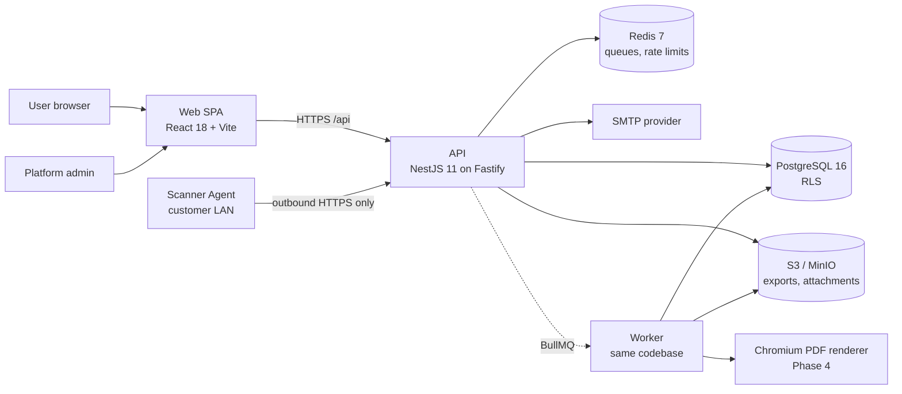
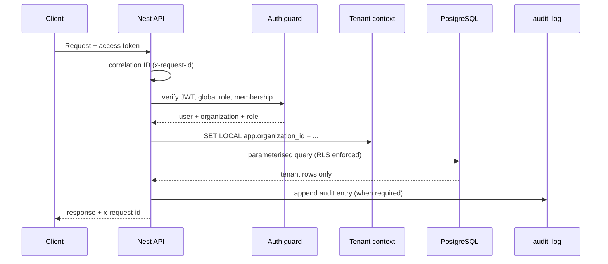
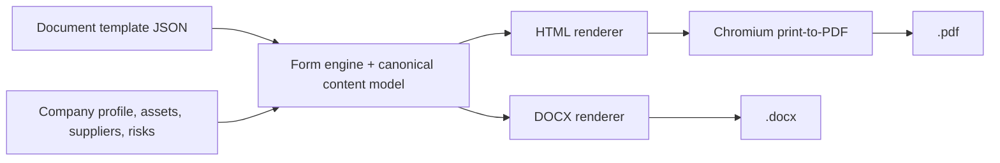

# Architecture

> This tool supports compliance preparation and does not constitute legal advice.

## 1. Scope and constraints

NIS2 Compass is a multi-tenant SaaS for EU SMEs. It has four functional pillars:

1. **Classification** — determine Essential / Important / Likely-in-scope / Out-of-scope with the
   reasoning and legal basis.
2. **Documentation** — template-driven documents with revisions, approvals and professional
   DOCX/PDF exports.
3. **Security audit** — network inventory, per-device posture, findings/remediation, dated audit
   snapshots and reports.
4. **Administration** — cross-tenant overview, read-only drill-down and audited assistance.

Hard constraints that shape the architecture:

- The platform stores sensitive network and security data, so it must meet ASVS L2 itself.
- Tenants must be isolated at the query layer **and** in the database.
- A web app cannot scan a customer LAN; scanning needs an outbound-only agent.
- Legal content must be data, versioned, and reviewable — never hardcoded or invented.
- DOCX and PDF exports must share one template definition and one visual language.
- English and Romanian from day one; jurisdiction packs pluggable as data.

## 2. System context



The API and worker are the same codebase with different entrypoints. The only genuinely separate
deployable is the Scanner Agent.

## 3. Architecture decisions

| #   | Decision                                               | Rationale                                                                      | Consequences                                                                                      |
| --- | ------------------------------------------------------ | ------------------------------------------------------------------------------ | ------------------------------------------------------------------------------------------------- |
| A1  | Modular monolith + shared worker                       | One tenant-scoped database; SME scale; avoids distributed transactions         | Module boundaries must be enforced by review; extract services only if a real bottleneck appears  |
| A2  | NestJS 11 on the Fastify adapter                       | Nest DI/modules fit the domain; Fastify gives perf and schema-based validation | Some middleware assumes Express; use Fastify-native plugins (helmet, cors, cookie)                |
| A3  | Prisma 6                                               | Type-safe client, migrations, JSONB support                                    | RLS and triggers are raw SQL migrations; runtime role separation in Phase 1                       |
| A4  | Go Scanner Agent                                       | Static binary, tiny distroless image, easy cross-compile, strong concurrency   | A second language in the repo; CI builds/tests it                                                 |
| A5  | Playwright/Chromium for PDF                            | Reuses the Chromium stack already needed for E2E; no second renderer           | Phase 4 adds a dedicated PDF worker image with bundled fonts                                      |
| A6  | One canonical content model → DOCX + PDF               | "Identical look" cannot come from two independent template files               | Build an intermediate representation (headings, tables, callouts, matrices) and two renderers     |
| A7  | Rules/templates/jurisdictions as versioned JSON        | Legal content must be reviewable without code changes                          | Seeds + admin review workflow; Zod validation at load time                                        |
| A8  | pnpm workspaces + Turborepo                            | Fast, disk-efficient, dependency-aware builds                                  | Turborepo telemetry can be disabled in CI                                                         |
| A9  | Helm for Kubernetes                                    | Many objects; values per environment                                           | Phase 9; k3s and managed K8s both documented                                                      |
| A10 | Access token in SPA memory; refresh in HttpOnly cookie | XSS cannot exfiltrate the refresh token; no localStorage tokens                | Silent refresh on boot; CSRF protection required                                                  |
| A11 | Tenant isolation twice: app scoping + RLS              | Defense in depth; a missed `WHERE` cannot leak cross-tenant data               | Every business table carries `organizationId`; runtime role must not be superuser/BYPASSRLS       |
| A12 | Envelope encryption (AES-256-GCM) for sensitive fields | Protects SNMP credentials, local admin secrets, notes against DB compromise    | Key management via KMS/External Secrets; key rotation needs a re-wrap job                         |
| A13 | BullMQ on Redis                                        | Retries, backoff, visibility, simple operations                                | Redis loss delays exports/reminders; document recovery                                            |
| A14 | UUID v7 identifiers                                    | Time-ordered, index-friendly, non-guessable                                    | Stored as `text` via Prisma's default `String` mapping; native `uuid` migration is possible later |
| A15 | Four-value classification result                       | Ambiguity is real; "likely in scope" avoids false certainty                    | UI must explain the required confirmation step                                                    |
| A16 | AI assist deferred; provider interface designed now    | No customer data leaves the tenant without opt-in                              | Feature flag off by default; draft flag in content model                                          |

## 4. Backend module map

| Module           | Phase | Responsibility                                                          |
| ---------------- | ----- | ----------------------------------------------------------------------- |
| `platform`       | 0     | Health, readiness, Prometheus metrics                                   |
| `auth`           | 1     | Registration, verification, login, refresh rotation, MFA, sessions      |
| `organizations`  | 1     | Tenant profile, memberships, owner invites                              |
| `users`          | 1     | Self-service profile, locale, GDPR export/erasure                       |
| `classification` | 2     | Rules engine, versioned runs, result summary                            |
| `documents`      | 3     | Template instances, autosave, revisions, versions, approvals            |
| `audits`         | 5–7   | Dated snapshots, devices, assessments, zones, connections, imports      |
| `findings`       | 7     | Findings, remediation, risk acceptance, risk-register feed              |
| `agents`         | 6     | Enrollment, heartbeat, scan ingestion, diff merges                      |
| `exports`        | 4     | DOCX/PDF/ZIP/summary jobs and download authorization                    |
| `notifications`  | 8     | In-app notifications and email reminders                                |
| `admin`          | 8     | Cross-tenant reads (audited), account controls, read-only impersonation |

Modules are empty in Phase 0 by design: the boundaries and dependency direction exist before the
features that fill them.

## 5. Request lifecycle



- **Correlation IDs** come from `x-request-id` (max 128 chars) or a UUID; they are echoed in the
  response and in every log line.
- **Validation** uses Zod schemas shared with the SPA, via `ZodValidationPipe`.
- **Errors** use a single envelope: `{ error: { code, message, correlationId, details? } }`. 5xx
  responses never leak internals.
- **Audit** is append-only: a trigger rejects `UPDATE`/`DELETE`; RLS limits tenant reads.

## 6. Authentication and authorization (Phase 1 design)

- **Passwords:** Argon2id, minimum 12 characters, breached-password check (k-anonymity HIBP or an
  offline list), no composition theatre.
- **Access token:** JWT, 10–15 minutes, kept in SPA memory only.
- **Refresh token:** random 256-bit value, stored hashed, rotated on every use, delivered in
  `HttpOnly; Secure; SameSite=Strict` cookie. Reuse of a rotated token revokes the whole family.
- **MFA:** TOTP with hashed recovery codes. Optional for users, **mandatory for admins**.
- **Sessions:** list/revoke per device; last-seen tracking.
- **Lockout:** progressive, per account and per IP, backed by Redis.
- **CSRF:** double-submit token plus `SameSite=Strict`; state-changing endpoints reject missing
  tokens.
- **Admin bootstrap:** one-time CLI seed only, never via the public UI. Users can never promote
  themselves or create admins.
- **Admin access:** read-only drill-down, every access written to the audit log before data is
  returned, impersonation limited to read-only.

## 7. Tenancy and data access

```
User ──< Membership >── Organization ──< business data
```

- A user can belong to multiple organizations (consultant/partner scenario).
- `memberships.role` is `OWNER` or `MEMBER`; the global `users.globalRole` is `USER` or `ADMIN`.
- Every business table carries `organizationId`.
- The query layer injects `organizationId` through a Prisma client extension (Phase 1).
- PostgreSQL RLS policies are already installed (migration `0002_rls`) and use
  `app.current_organization_id()`.
- **Runtime roles (Phase 1):** migrations/seeds run as an owner role; the API runs as a
  non-owner, non-BYPASSRLS role with minimal grants. The dev Compose stack currently uses a
  superuser, which bypasses RLS; the isolation test in the Phase 0 report used a dedicated
  non-superuser role.
- **Admin reads** use a narrowly scoped, pre-audited bypass; they are never silent.

## 8. Documentation and export pipeline



- The template definition is the single source of truth: sections, fields, validation, weights,
  export layout and legal references.
- The canonical content model contains headings, paragraphs, lists, tables, callouts, RACI and
  risk matrices, revision history, signature blocks and page-break hints.
- The DOCX renderer maps tokens to real Word styles and colors; the HTML renderer maps the same
  tokens to CSS variables. Both use primary-600 table headers, primary-50 zebra rows and the fixed
  severity colors.
- Exports are queued jobs (BullMQ) written to S3/MinIO with short-lived download URLs.

## 9. Scanner Agent

- The user creates a one-time enrollment token in the UI; the agent exchanges it for a scoped
  credential (Phase 6).
- Communication is **outbound HTTPS only**; no inbound ports on the customer network.
- Discovery order: ARP sweep on L2, ICMP/TCP reachability, reverse DNS, mDNS/NetBIOS/SNMP (opt-in,
  credentials supplied by the user), OUI vendor lookup, optional top-100 TCP fingerprint and OS
  guess.
- **No exploitation, no credential attacks, no intrusive probes.**
- MAC addresses are visible only on the same L2 segment; the UI states this explicitly.
- Imports (Nmap XML, CSV, manual) provide fallbacks when the agent cannot run.
- Rescans **diff** against the existing map: new, missing and changed devices are proposed, never
  auto-overwriting the user's layout or notes.

## 10. Jobs and background processing

- Redis + BullMQ, queue `exports`; the worker is the same codebase with `worker.ts` as entrypoint.
- Jobs are idempotent and carry an organization ID plus actor ID for audit.
- Export jobs produce DOCX/PDF/ZIP/summary artifacts in object storage; status is polled by the SPA.
- Phase 8 adds reminder and retention cron jobs; Phase 9 moves them to Kubernetes CronJobs.

## 11. Observability

- Structured JSON logs via pino, with request IDs, service name and redaction.
- Prometheus metrics at `/metrics` (default process metrics now; HTTP/queue/business metrics next).
- `/healthz` is dependency-free; `/readyz` checks PostgreSQL and Redis and returns 503 if either is
  down.
- OpenTelemetry tracing is scaffolded by configuration and lands in Phase 9.

## 12. Deployment topology

- **Now:** Docker Compose for local development and a production-like smoke stack.
- **Phase 9:** Helm chart for Kubernetes, compatible with a single-node k3s VM and managed K8s.
  Deployments for web/api/worker, NGINX ingress + cert-manager, External Secrets, HPA, PDB,
  NetworkPolicies, Pod Security "restricted", migration Job, CronJobs, backup verification.
- PostgreSQL is recommended as a managed service in production; CloudNativePG is the self-hosted
  option.
- Migrations follow expand/contract so rolling updates never require simultaneous schema and code
  changes.

## 13. Deliberate Phase 0 boundaries

Not implemented yet (by plan): auth, tenant runtime role separation, classification content,
document templates, export renderers, device APIs, active scanning, findings APIs, admin dashboard,
Helm, observability stack, load/security testing, SBOM/cosign.

## 14. Trade-offs and risks

| Risk                                          | Mitigation                                                                                            |
| --------------------------------------------- | ----------------------------------------------------------------------------------------------------- |
| Prisma does not model RLS                     | Raw SQL migrations + a Phase 1 tenant-context extension + integration tests with a non-superuser role |
| Two renderers could drift                     | One canonical content model and a token-parity test in Phase 4                                        |
| Text UUIDs use more space                     | Acceptable at SME scale; a native `uuid` migration path is documented                                 |
| Legal content can become stale                | Versioned packs, review status, changelog and a qualified review workflow                             |
| Redis is a single point of failure for queues | Persistent Redis, retries, readiness checks; jobs are reconstructible from DB intent records          |
| Fastify adapter differences                   | Prefer Fastify-native plugins; no Express-only middleware                                             |
