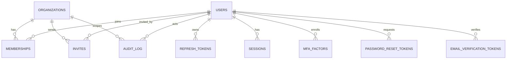
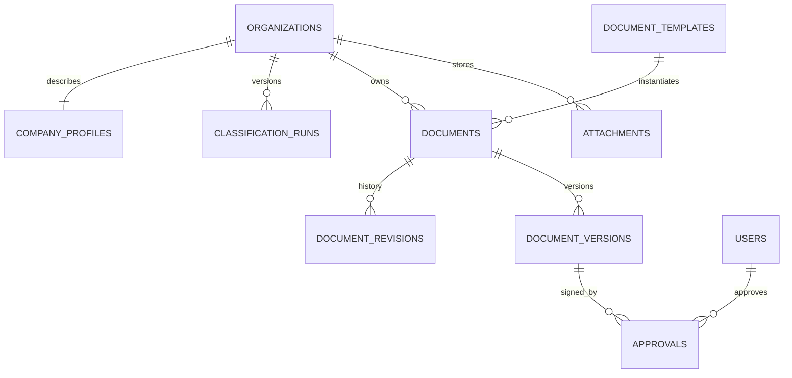
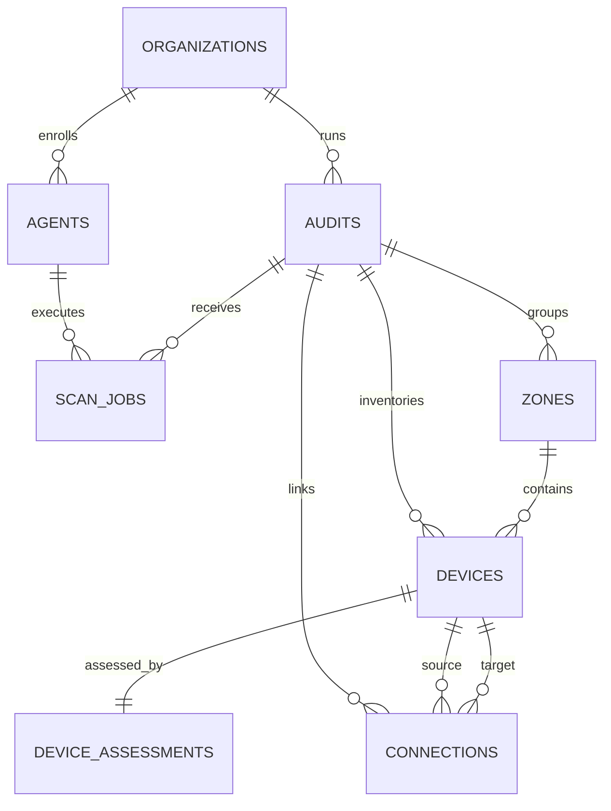
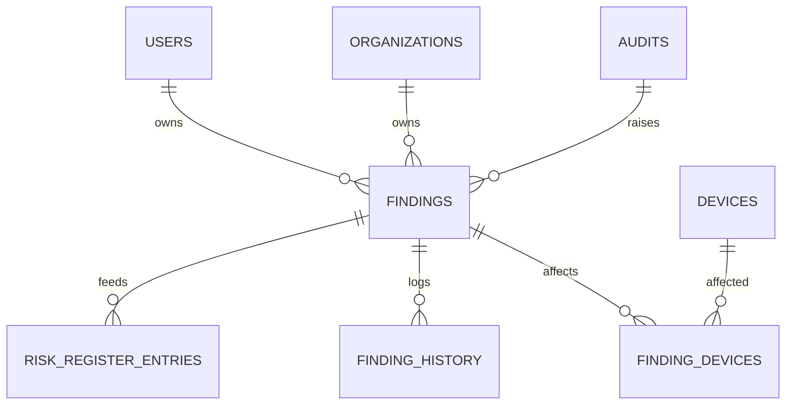
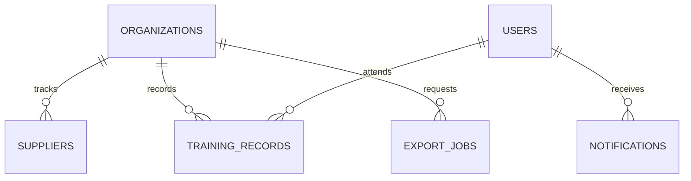

# Data model and ERD

> Canonical schema: [`apps/api/prisma/schema.prisma`](../apps/api/prisma/schema.prisma).
> Migrations: `apps/api/prisma/migrations/`.
> This tool supports compliance preparation and does not constitute legal advice.

## 1. Conventions

- **IDs:** UUID v7 values (`@default(uuid(7))`), time-ordered and non-guessable. Prisma's default
  `String` mapping stores them as `text`; a future migration can switch to native `uuid` without
  changing API contracts.
- **Tenancy:** every business table carries `organizationId`. Child tables that are reachable only
  through a parent still carry it so RLS applies directly (for example `document_revisions`).
- **Timestamps:** UTC; rendered in the user's locale.
- **JSONB:** used for template-driven form payloads, snapshots, rule inputs/basis, evidence and
  flexible assessment data. Each payload is validated against the template schema before save.
- **Immutability:** revisions, finding history and the audit log are append-only. Restores create a
  new revision.
- **Naming:** Prisma models are PascalCase; tables are snake_case via `@@map`; columns keep
  camelCase and are quoted in raw SQL.

## 2. Entity-relationship diagrams

### Identity, tenancy and security



`audit_log` references users and organizations logically, not through foreign keys: `ON DELETE SET
NULL` would update the append-only trail and hit its trigger. The UUIDs are retained as immutable
references when an account or organization is deleted.

### Company profile, classification and documents



`jurisdiction_packs` is referenced by `classification_runs.jurisdictionPackCode` +
`jurisdictionPackVersion` (a version pin, not a foreign key), so historical results remain
reproducible after a pack is superseded.

### Audits, network map and agents



### Findings, remediation and risk



### Operations and shared single-source-of-truth entities



Suppliers, assets/devices, risks and training records are the **single source of truth** shared by
the audit module and the document module. A supplier entered in the supplier register and the
supply-chain document are the same row, not duplicates.

## 3. Entity inventory

| Entity                                                | Purpose                                                                              | Key relationships / constraints                                                                             |
| ----------------------------------------------------- | ------------------------------------------------------------------------------------ | ----------------------------------------------------------------------------------------------------------- |
| `organizations`                                       | Tenant root; plan, scope mode, jurisdiction                                          | `slug` unique                                                                                               |
| `users`                                               | Global account, Argon2id hash, global role, MFA flag                                 | `email` unique                                                                                              |
| `memberships`                                         | User ↔ organization with `OWNER`/`MEMBER`                                            | unique `(organizationId, userId)`                                                                           |
| `invites`                                             | One-time colleague invitation                                                        | `tokenHash` unique                                                                                          |
| `refresh_tokens`                                      | Rotating refresh tokens with family reuse detection                                  | `tokenHash` unique, `familyId` index                                                                        |
| `sessions`                                            | Device/session list, selected organization, revocation                               | optional `refreshTokenId`                                                                                   |
| `mfa_factors`                                         | TOTP secret (encrypted), hashed recovery codes, replay step                          | per-user                                                                                                    |
| `password_reset_tokens` / `email_verification_tokens` | Single-use, expiring tokens                                                          | `tokenHash` unique                                                                                          |
| `audit_log`                                           | Append-only security trail; admin cross-tenant access                                | trigger blocks UPDATE/DELETE; no FKs (immutable denormalized actor/organization references)                 |
| `company_profiles`                                    | Shared company identity, contacts, DPO/CISO, size data                               | one per organization                                                                                        |
| `classification_runs`                                 | Versioned inputs, result, rule, legal basis, consequences, document applicability    | unique `(organizationId, version)`                                                                          |
| `jurisdiction_packs`                                  | Versioned legal content as data                                                      | unique `(code, version)`                                                                                    |
| `document_templates`                                  | Versioned JSON form/export definitions                                               | unique `(key, version)`; one active version per key                                                         |
| `documents`                                           | One instance per org/template; payload, status, owner, pinned template version, lock | unique `(organizationId, templateId)`; `templateVersion` flags template changes                             |
| `document_revisions`                                  | Immutable save history with changed fields and pinned template version               | unique `(documentId, revisionNo)`                                                                           |
| `document_versions`                                   | Named versions (v1.0, v1.1), publisher and approval state                            | unique `(documentId, versionLabel)`                                                                         |
| `approvals`                                           | Approver, signature, comment, date                                                   | per version                                                                                                 |
| `attachments`                                         | S3 objects with hash, scan status, encryption flag                                   | polymorphic `entityType/entityId`                                                                           |
| `audits`                                              | Dated snapshots with scope, methodology, limitations                                 | per organization                                                                                            |
| `agents`                                              | Enrollment, token hash, platform, last seen                                          | `tokenHash` unique                                                                                          |
| `scan_jobs`                                           | Requested/ingested scans and summaries                                               | audit/agent optional                                                                                        |
| `zones`                                               | LAN/DMZ/Guest/Server/Cloud containers                                                | unique `(auditId, name)`                                                                                    |
| `devices`                                             | Identity, network data, layout, completeness                                         | per audit; MAC index                                                                                        |
| `device_assessments`                                  | Per-tab security posture JSON + completeness                                         | one per device                                                                                              |
| `connections`                                         | Wired/wireless/VPN edges with speed/VLAN                                             | source/target devices                                                                                       |
| `findings`                                            | Remediation register, severity, status, risk acceptance                              | unique `(organizationId, code)`                                                                             |
| `finding_devices`                                     | Explicit many-to-many with `organizationId`                                          | composite PK                                                                                                |
| `finding_history`                                     | Append-only change log                                                               | per finding                                                                                                 |
| `risk_register_entries`                               | Risk register fed by findings                                                        | optional `sourceFindingId`                                                                                  |
| `suppliers`                                           | Supplier register with risk rating                                                   | per organization                                                                                            |
| `training_records`                                    | Awareness/management training log                                                    | optional user + expiry                                                                                      |
| `notifications`                                       | In-app and email reminder state                                                      | per user                                                                                                    |
| `export_jobs`                                         | DOCX/PDF/ZIP/summary job state, entity reference and private artifact key            | `entityType` + `entityId` for documents; `entityIds` stores locale/format; status `QUEUED`-`READY`/`FAILED` |

## 4. Row Level Security

Migration `0002_rls` creates `app.current_organization_id()` and applies `FORCE ROW LEVEL SECURITY`
to every tenant table.

| Table group                                                                                                                       | Policy                                                                                       |
| --------------------------------------------------------------------------------------------------------------------------------- | -------------------------------------------------------------------------------------------- |
| `organizations`                                                                                                                   | `id = app.current_organization_id()`                                                         |
| All tables with `organizationId`                                                                                                  | `organizationId = app.current_organization_id()` for `USING` and `WITH CHECK`                |
| `audit_log`                                                                                                                       | tenant `SELECT` only; `INSERT` allowed for own org or system rows (`organizationId IS NULL`) |
| `audit_log` mutations                                                                                                             | rejected by trigger `audit_log_append_only`                                                  |
| Child tables (`document_revisions`, `document_versions`, `approvals`, `finding_devices`, `finding_history`, `device_assessments`) | carry `organizationId` for direct RLS                                                        |

The API sets the tenant per transaction:

```sql
SET LOCAL app.organization_id = '<organization-uuid>';
```

**Phase 1 applied (migration `0003_auth_rls`):**

1. `app.current_user_id()` plus user-scoped `organizations` and `memberships` policies allow
   organization discovery before an organization is selected.
2. `invites` can be looked up by `app.invite_token_hash` before the account exists.
3. `audit_log` reads allow the actor as well as the tenant.
4. `sessions.organizationId` stores the selected organization; `mfa_factors.lastUsedStep` prevents
   TOTP replay.
5. `TenantPrismaService` runs tenant/user/invite queries in a transaction with `set_config(...,
true)`, so context never leaks across pooled connections.
6. The runtime role is created by `prisma/setup-runtime-role.ts` (LOGIN, NOSUPERUSER, NOBYPASSRLS,
   minimal DML/execute grants).

Still required: DB-backed integration tests in CI that run as the non-superuser role.

## 5. Indexing and constraints

- Composite indexes lead with `organizationId` for tenant scans
  (`findings(organizationId, status, severity)`, `documents(organizationId, status)`, …).
- `device.macAddress` is indexed for rescan matching; IPs are stored as `text[]` and matched in the
  application layer.
- Unique constraints encode business invariants: one document per template per org, one revision
  per number, one zone name per audit.
- `findings.code` is unique per organization; nullable codes allow drafts.
- Foreign keys use `Cascade` for tenant-owned data and `SetNull` for optional actors/owners so
  deletions do not destroy audit context.

## 6. JSONB payload conventions

| Column                                                   | Shape                                                                             | Validation                                 |
| -------------------------------------------------------- | --------------------------------------------------------------------------------- | ------------------------------------------ |
| `document_templates.schema`                              | sections → fields, validation, weights, prefill/conditional logic, export mapping | Zod at load/seed                           |
| `documents.payload` / `document_revisions.payload`       | `{ fieldKey: value }`                                                             | template schema version pinned in revision |
| `document_revisions.changedFields`                       | `{ fields: string[] }`                                                            | computed from the previous revision        |
| `document_versions.status`                               | `DRAFT` / `APPROVED` / `SUPERSEDED`                                               | version lifecycle                          |
| `company_profiles.contactPoints/dpo/ciso/managementBody` | structured contact objects                                                        | Zod                                        |
| `classification_runs.inputs/legalBasis/consequences`     | questionnaire snapshot and cited rules                                            | rules engine with legal references         |
| `classification_runs.applicability`                      | per-document applicability/priority snapshot                                      | pack document rules + engine validation    |
| `device_assessments.data`                                | per-tab posture object                                                            | per-device-type required-field rules       |
| `findings.evidence/riskAcceptance`                       | attachments, justification, approver                                              | Zod                                        |
| `audit_log.metadata`                                     | action-specific safe context                                                      | never secrets or full payloads             |

Every revision stores the template version so a later template change cannot silently reinterpret
historical data.

## 6a. Phase 5 network mapper

Phase 5 adds **no schema migration**. It uses the existing `audits`, `zones`, `devices`,
`device_assessments` and `connections` tables and their Phase 0 RLS policies.

- `devices.position` stores `{x, y}` absolute canvas coordinates; `zones.bounds` stores
  `{x, y, width, height}`. Both are validated before save.
- `device_assessments.data` is the posture object (software, protection, access, backup, network,
  data, logging, physical). The shared `deviceAssessmentDataSchema` rejects unknown keys.
- Required fields are type-specific and computed by
  `packages/shared/src/network/completeness.ts`. The result is denormalized to
  `devices.completeness` and `devices.informationComplete` for cheap list rendering; the API
  recomputes before accepting "complete".
- Risk indicators are derived, not stored. They can change when a licence/patch/backup date passes.
- `devices.macAddress` is normalized to `AA:BB:CC:DD:EE:FF`. Import matching uses the indexed MAC
  plus the `ipAddresses` array.
- `connections` are audit-scoped and validated to reference two devices in the same audit. Duplicate
  pairs are rejected in either direction.
- `zones` are unique by `(auditId, name)`. Deleting a zone sets its devices' `zoneId` to null.

## 7. Field-level encryption map (Phase 1+)

Envelope encryption: a per-organization data key (AES-256-GCM) wrapped by a KEK in KMS/Vault.

| Data                                                       | Location                                       | Reason                        |
| ---------------------------------------------------------- | ---------------------------------------------- | ----------------------------- |
| TOTP secrets, recovery code hashes                         | `mfa_factors`                                  | Account takeover prevention   |
| SNMP v2c/v3 community/credentials, local admin credentials | `device_assessments.data` (encrypted envelope) | Network compromise prevention |
| Free-text device notes containing sensitive details        | `device_assessments.data`                      | Customer confidentiality      |
| Attachment bodies                                          | S3 object encryption (SSE-KMS) + app-level DEK | Data at rest                  |
| Export artifacts                                           | S3 SSE-KMS, short-lived signed URLs            | Data at rest and in transit   |

Admins can never read passwords, MFA secrets or encrypted device credentials.

## 8. Migration strategy

- **Expand/contract** for zero-downtime deploys: add nullable columns/tables first, backfill, switch
  reads, then remove old columns in a later release.
- RLS policies are applied in the same PR as the table they protect.
- Never edit an applied migration; add a new one.
- Seed data is idempotent (`upsert`) and limited to metadata/demo data in Phase 0.
- CI runs `prisma migrate deploy` against a disposable PostgreSQL service before tests in Phase 1.

## 9. Adding a tenant-scoped table — checklist

1. Add `organizationId String` and the relation to `Organization`.
2. Add `@@index([organizationId, …])` for the primary access path.
3. Add the table to the RLS loop in a new migration (or a dedicated policy).
4. Add the Prisma tenant extension rule (Phase 1+).
5. Add authorization tests proving another tenant cannot read or write it.
6. Document the retention and audit requirements for the new data.
